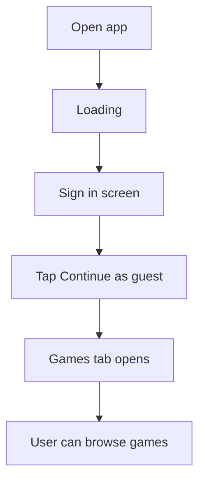
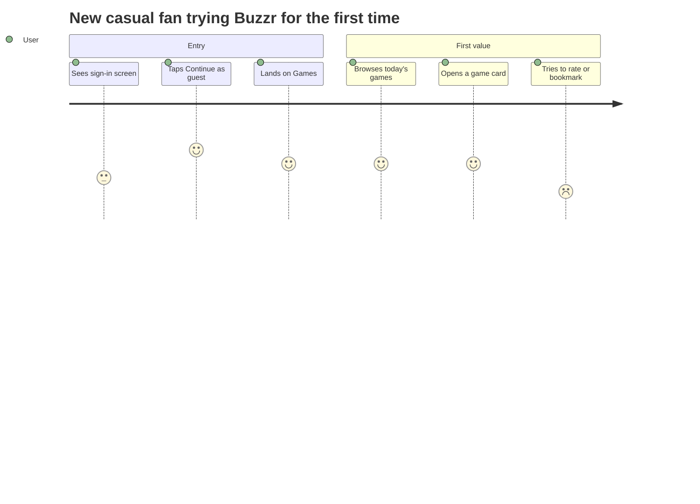

# 🧜‍♀️🍓 Mermaid Jam

Paste Mermaid or markdown. Generate clean, editable FigJam userflows.

[](https://github.com/sarveshsea/mermaid-jam/actions/workflows/ci.yml)
[](https://github.com/sarveshsea/mermaid-jam/releases)
[](./LICENSE)
[](https://www.figma.com/community/plugin/1631708567749401678)

Mermaid Jam is a local-only FigJam plugin that converts pasted Mermaid diagrams and markdown journey notes into native FigJam sections, shape cards, and dynamic connectors. It is built for product teams, designers, engineers, founders, and anyone who wants fast diagrams that remain editable after generation.

[Open on Figma Community](https://www.figma.com/community/plugin/1631708567749401678) · [Landing page](https://sarveshsea.github.io/mermaid-jam/) · [Examples](./examples) · [Distribution plan](./docs/DISTRIBUTION.md) · [Privacy](./PRIVACY.md)

## Why Use It

- Turns copied Mermaid into editable FigJam boards instead of static screenshots.
- Keeps everything local: no accounts, no backend, no analytics, no network access.
- Supports dynamic FigJam connectors that stay attached when cards move.
- Preserves manually moved node positions during updates when IDs match.
- Gives line-level diagnostics before generation so broken diagrams are fixable.
- Includes layout presets, connector routing controls, semantic styling, and journey score views.
- Always contains generated output inside a FigJam section for clean boards and printing.

## Supported Inputs

Mermaid Jam supports:

- `flowchart` / `graph`: `TD`, `TB`, `BT`, `LR`, `RL`, chained edges, edge labels, dotted/thick edges, and common Mermaid node shapes.
- `journey`: sections, tasks, actors, scores, stage averages, bottlenecks, and insight summaries.
- `sequenceDiagram`: flattened into ordered interaction cards.
- `stateDiagram` / `stateDiagram-v2`: converted into editable state-flow nodes.
- `mindmap`: converted into a left-to-right tree.
- `timeline`: converted into a horizontal event flow.
- Markdown userflow notes: headings, bullets, simple arrows, and journey notes.

Unsupported Mermaid types, including `pie`, `gantt`, `erDiagram`, and `classDiagram`, return explicit diagnostics instead of silently generating bad output.

## Example



Paste that into Mermaid Jam, click **Generate**, then move the generated FigJam cards freely. Connectors stay attached.

## User Journey Example



Journey mode can render clean timelines, score views, or insight summaries with bottleneck callouts.

## Controls

- **Layout:** Compact, Readable, Presentation, Print, Wide Map, Deep Tree.
- **Routing:** Direct, Elbow, Avoid Nodes, More Spacing, Loop Friendly.
- **Update:** Preserve moved nodes or reset deterministic layout.
- **Journey View:** Clean, Scores, Insights.
- **Semantics:** Auto, custom keyword rules, or depth-only color layers.
- **Revise:** Local rules-based cleanup for rough Mermaid and markdown source.

## Install For Development

```bash
git clone https://github.com/sarveshsea/mermaid-jam.git
cd mermaid-jam
npm install
npm run build
```

Then import `plugin/manifest.json` from Figma using **Plugins > Development > Import plugin from manifest...**.

The manifest is importable from Figma and FigJam, but generation requires a FigJam board because the renderer uses native FigJam shapes and connectors.

## Copy-Paste Examples

- [Flowchart](./examples/flowchart.md)
- [Journey map](./examples/journey.md)
- [Sequence diagram](./examples/sequence.md)
- [Markdown userflow](./examples/markdown-userflow.md)

## Help The Project Grow

- Star the repo if Mermaid Jam saves you time.
- Share the Figma Community listing with designers who use Mermaid.
- Open issues with real Mermaid examples that do not convert cleanly.
- Submit small parser/layout improvements with tests.

## Commands

```bash
npm run typecheck       # TypeScript validation
npm test                # Parser, layout, UI, and renderer tests
npm run build           # Build plugin/code.js and plugin/ui.html
npm run check           # Typecheck, tests, build, and bundle integrity
npm run publish:check   # Full publish-readiness validation
```

## Publish Status

This repo is configured for Figma Community submission:

- Manifest ID: `1631708567749401678`
- Compatibility: Figma import + FigJam generation
- Document access: `dynamic-page`
- Network access: `allowedDomains: ["none"]`
- No analytics, backend, AI service, or external assets

## Privacy

Mermaid Jam runs locally in FigJam. Source text is stored only in Figma plugin data on generated nodes so diagrams can be loaded and updated later. Nothing is sent to a server.

## License

MIT. See [LICENSE](./LICENSE).
